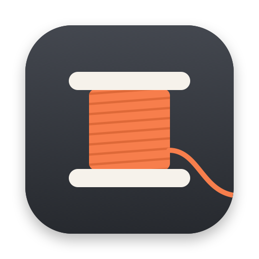
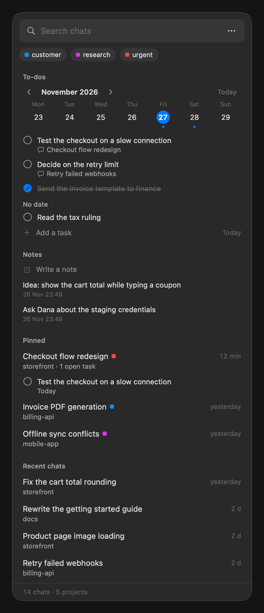
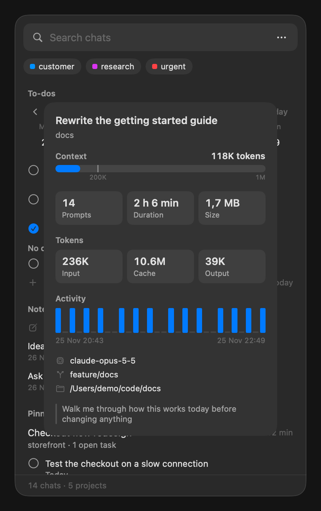
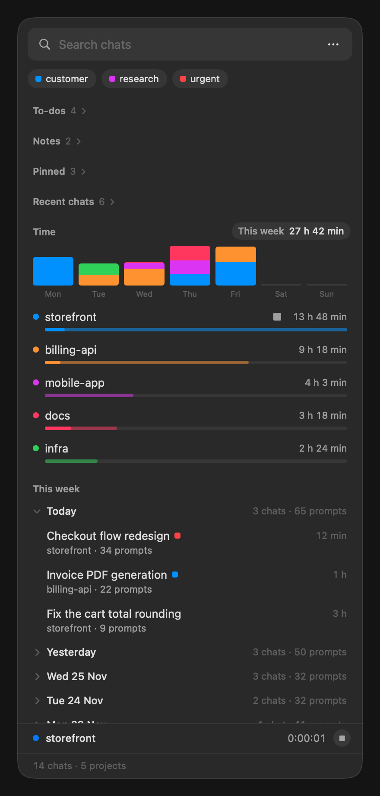
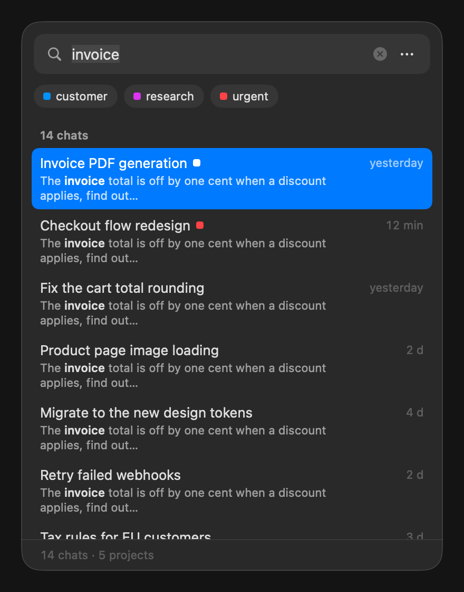

<p align="center"></p>

# Respool

A side panel for your Claude Code sessions on macOS. It slides in from the right edge of the
screen, lists every session from every project on your Mac, searches inside them, takes you
back to the one you pick, and shows how long you worked on each project.

Respool is an independent project and is not affiliated with Anthropic.

> The interface is in English and Turkish. It follows your system language unless you pick one
> in Settings.

<p align="center">
  
  
</p>
<p align="center">
  
  
</p>

The screenshots show made-up data.

## What it does

- **Search.** Searches session titles and the conversations themselves, and shows an excerpt
  of the match.
- **Projects.** Groups sessions by git remote, so one repository checked out in several
  folders shows up as one project. Projects can be merged and renamed by hand. The menu beside
  the list's title sorts them by last activity, name, session count or token use, and leaves
  out those with a single session or none in the last 30 days. A project can be hidden from its
  context menu; hidden projects are still found by search and come back in Settings.
- **Pins and tasks.** Pin the sessions you keep returning to and keep a short task list on each.
  Drag a pinned session or an open task onto another one to change their order.
- **Calendar.** Plan tasks by day on a calendar at the top of the panel. It shows a week, or a
  whole month when you click its title, with a dot under each day that has open tasks. Tasks
  whose day has passed are listed with today's.
- **Tasks linked to a session or project.** Add a task from a session's or project's context
  menu and it stays attached to it. A linked task has a run button: for a session, the task
  goes on the clipboard and the session opens; for a project, a new session starts in the
  project's folder with the task as its first prompt. A task's own context menu sets its day,
  moves it to a project, or deletes it.
- **Tags.** Give sessions colored tags and filter the list by tag.
- **Week.** A summary of the week so far: a row for each day with the sessions used that day and
  how many prompts went into each. A day opens onto its sessions; today is open to begin with.
  The summary can be turned off in Settings.
- **Time.** How long each project was worked on today, this week and this month. Today is a
  timeline of the day with every project in its own color; a week or a month is a column for
  each day. Time comes from two sources, and a minute found in both is counted once:
  a timer you start and stop on a project (it shows in the menu bar while it runs, and stops
  when the Mac sleeps), and automatic time worked out from when prompts were typed and
  answered. Moments closer together than the idle gap (15 minutes unless you change it) count
  as one stretch of work. Automatic time measures time with Claude Code, not time spent in
  meetings or editing by hand; it can be turned off in Settings. On the charts the timer's part
  is drawn solid and the automatic part lighter.
- **Notes.** Jot a line down from anywhere with the quick-note shortcut; turn it into a task later.
- **Notifications.** When a session finishes or starts waiting for you, Respool posts a
  notification and shows a count next to its menu bar icon. Clicking the notification opens
  the session.
- **Deletion warning.** Claude Code deletes the transcript of a terminal session it has not
  written to for 30 days (`cleanupPeriodDays` in its settings); sessions the desktop app keeps
  are exempt. In a session's last week Respool marks its row and shows a bar at the top of the
  panel that names those sessions with the days each has left (a click opens one) and copies all such transcripts into a `Backups` folder beside the index. Any session
  can also be backed up from its context menu, and a session with a copy says so instead of
  warning. The copies are the transcripts themselves; Respool keeps them and reads nothing
  from them.
- **Live status.** Shows which sessions are running, and whether Claude is working or waiting
  for you.
- **Prompt outline.** Open any session's outline to read everything you asked in it, in order,
  without opening the session itself.
- **Details on hover.** Rest the pointer on a session or project for a card with a context
  gauge, token usage, an activity chart, transcript size, model, branch and folder.
- **Waiting for you.** Sessions that are waiting for an answer, or that finished while you were
  elsewhere, are listed at the top of the panel.
- **Opening.** By default a session opens where it lives: in the Claude desktop app, by
  bringing its terminal forward, or by resuming it in a new terminal. Respool notes which app
  each running session is in (Terminal, iTerm, an editor, the Claude app) and later reopens
  the session there, and starts a project's new sessions where its sessions have been
  running. In iTerm a session resumes in a new tab of the front window; macOS asks once for
  permission to control iTerm, and Settings can go back to a new window. Terminal has no
  command for opening a tab, so there it is always a window. Settings can send
  sessions somewhere else instead (the Claude app, Terminal, iTerm, VS Code, Cursor or Zed,
  whichever are installed), each project can have its own choice from its context menu, and a
  session's context menu opens it any of these ways once. An editor is opened on the
  project's folder with `claude --resume …` on the clipboard, ready to paste into its
  terminal, since an editor cannot be handed a command. A session that is running always
  opens where it runs. The button on a project's row starts a new session in its folder.
- **Updates.** Settings checks GitHub for a newer release and shows the release notes. Nothing
  is asked of the network unless you press the button or turn the daily check on.
- **Accounts.** Optional. If you use several Claude organizations, a switcher narrows the list
  to one of them.

## Keys

| Key | Action |
|---|---|
| `⌥⇧Space` | Open or close the panel (all three shortcuts can be changed in Settings) |
| `⌥⇧T` | Open the panel on the task field |
| `⌥⇧N` | Open the panel on the note field |
| `↑` `↓` | Move through sessions |
| `↩` | Open the selected session |
| `esc` | Clear the search, then close the panel |

Hover a session for the pin button; everything else is in its context menu.

The panel opens from the right edge by default; Settings can move it to the left, top or
bottom. Or drag it by the margin around the search field or by the footer, and resize it from
its edges: it then stays where you put it, at the size you gave it, until you pick an edge
again. Settings also has the theme (system, light or dark) and the language.

The panel closes when you click elsewhere. "Keep the panel open", in Settings and in the panel's
menu, leaves it on screen instead, for a panel parked on a second display; it then closes
with its shortcut or `esc`.

The first time it starts, Respool shows a welcome screen in the middle of the display with the
shortcut, the panel's position, where chats open and whether to start at login. Settings can
show it again.

## Install

Requires macOS 14 or later and the Xcode command line tools.

```bash
git clone https://github.com/ademhatay/respool.git
cd respool
./scripts/install.sh
```

This builds the app, copies it to `/Applications/Respool.app` and starts it. To build without
installing, run `./scripts/bundle.sh`; the app lands in `build/Respool.app`.

## Your data

Respool only reads Claude Code's files. It never changes them, and nothing leaves your Mac.
The one request it can make is the update check, which asks GitHub's public API for this
repository's releases and sends nothing about you; it runs when you ask, or daily if you turn
that on.

| Source | Used for |
|---|---|
| `~/.claude/projects/**/*.jsonl` | Titles, dates, token usage and searchable text |
| `~/.claude/sessions/*.json` | Which sessions are running, and their state |
| `~/.claude.json` | The name of the organization you are signed in to |
| `~/Library/Application Support/Claude/claude-code-sessions` | Links to sessions in the desktop app |

These formats belong to Claude Code and can change between versions; Respool was written
against Claude Code 2.1.332. The index, pins, tasks, tags, notes and timer entries live in
`~/Library/Application Support/Respool/respool.db`.

## Limits

- A session that belongs to an organization the desktop app is not signed in to cannot be
  opened there. Respool says so; switch organization in the Claude app first.
- Token counts cover the main conversation, not subagents.
- Lines longer than 512 KB in a transcript are skipped by the indexer.
- The deletion warning reads `cleanupPeriodDays` from `~/.claude/settings.json`. A value set by
  an organization's managed settings is not visible to Respool, which then assumes 30 days.

## Development

```bash
.build/release/Respool --index --query "some phrase"       # update the index and try a search
.build/release/Respool --snapshot panel.png --dark         # draw the panel to an image
RESPOOL_DB=/tmp/test.db .build/release/Respool --selftest  # pins, tasks, tags, time and the rest
RESPOOL_DB=/tmp/demo.db .build/release/Respool --snapshot docs/panel.png --demo --lang en --dark  # screenshot with made-up data
swift scripts/make-icon.swift                              # regenerate the app icon
```

`scripts/release.sh` builds a copy for other Macs: signed with a Developer ID certificate,
notarized, and zipped. It needs `RESPOOL_SIGN_IDENTITY` and `RESPOOL_NOTARY_PROFILE`; the
script's header says what they are.

## License

MIT. See [LICENSE](LICENSE).
